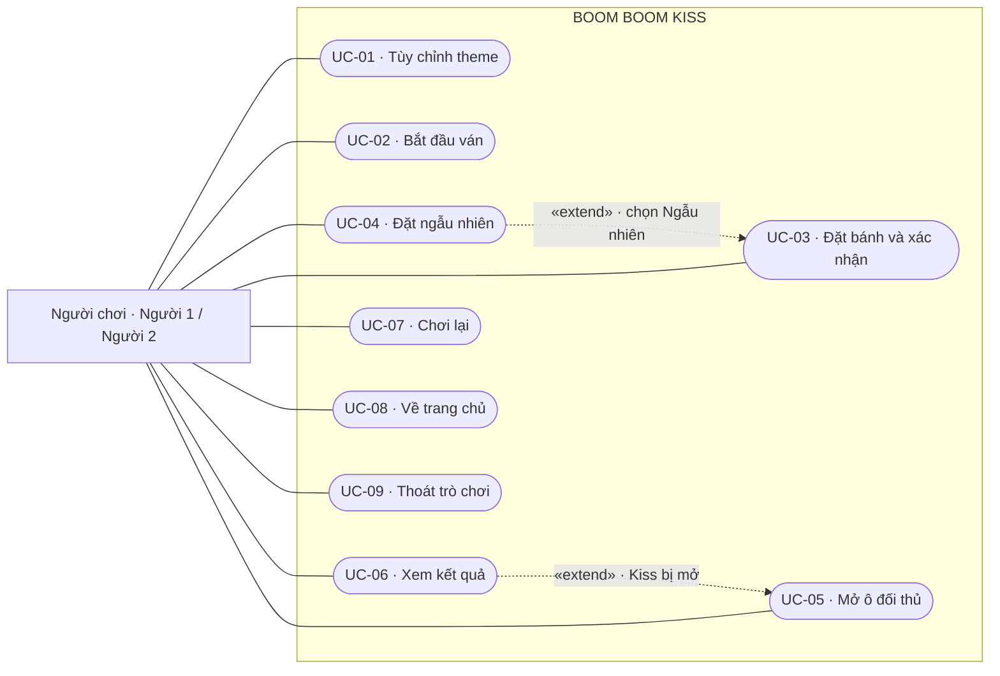

# Use Case — Boom Boom Kiss

## Cơ sở cập nhật và phạm vi

Cập nhật 11/10/2026 theo [ban-ke-su-that.md](ban-ke-su-that.md), lập từ source
và git diff --no-index với snapshot trước khi chỉnh Trang chủ. Bản kê là
cơ sở truy vết, không coi nội dung prompt là bằng chứng đã triển khai.
Giữ mã UC-01 đến UC-09. Chỉ mô tả chức năng có thật và nêu giới hạn riêng.

Hệ thống là game desktop local cho hai người dùng chung một máy: GUI, luật
chơi và lưu theme cục bộ. Actor là **Người chơi**; Người 1/Người 2 là hai vai
trò luân phiên. Game, timer, font và file properties nằm trong hệ thống,
không phải actor. Không có đăng nhập, server hoặc chơi online trong source.

## Danh mục và sơ đồ Use Case

Giữ UC-01 đến UC-08 để bảo toàn truy vết; UC-09 bổ sung thao tác thoát đã có
trong giao diện. Cùng mã được dùng ở sơ đồ, đặc tả và danh sách TC. Mermaid
dưới đây là biểu diễn tổng quan trên GitHub; `USE_CASE.puml` là nguồn UML.

UC-04 mở rộng UC-03 khi chọn bố trí ngẫu nhiên. UC-06 mở rộng UC-05 tại điểm
“Kiss vừa được mở”. Mũi tên đi từ use case mở rộng đến use case cơ sở.
Chơi lại, về trang chủ và thoát là lựa chọn riêng, không bắt buộc kèm kết quả.

Lưu/đọc theme, kiểm tra số bánh, che bàn, xử lý Safe/Boom/Kiss, nổ dây chuyền
và đổi lượt là bước trong các luồng bên dưới. Không tách thành use case mục
tiêu riêng và không tạo quan hệ include vòng.

## UC-01 — Tùy chỉnh theme

- **Actor:** Người chơi trước khi bắt đầu ván.
- **Tiền điều kiện:** Trang chủ đang mở.
- **Luồng chính — icon:** Ở thẻ “Chọn biểu tượng theo ý bạn”, bấm ô theo
  hướng dẫn “Bấm vào ô để đổi biểu tượng” → bảng 6 icon cùng loại mở →
  chọn hình → cập nhật ô, logo và icon trong thẻ Luật chơi → lưu theme.
  Ô đang thao tác có viền nhấn và nhãn đậm hơn.
- **Luồng thay thế — tên hiển thị:** Sửa ô nhãn riêng dưới icon, mặc định
  Safe/Boom/Kiss → cập nhật câu luật theo nhãn. Đây là tên hiển thị ở Trang
  chủ trong phiên, không đổi enum/luật/loại bánh. Không lưu nhãn vào theme.
  Nhãn được giữ khi trở về menu hoặc chơi lại, đặt lại mặc định khi mở một
  cửa sổ ứng dụng mới.
- **Luồng chính — hình phạt:** Nhập vào “Hành động khi thua”; cập nhật bộ
  nhớ từng lần sửa, không ghi từng ký tự. Ghi khi đổi icon, CHƠI hoặc xác
  nhận thoát. Nhãn phiên không kích hoạt việc ghi theme.
- **Nhánh thay thế:** Esc/bấm ra ngoài đóng bảng mà không chọn; không đổi
  theme. Lỗi ghi được thông báo, theme trong bộ nhớ vẫn dùng được. Quy tắc
  text trống khi bấm CHƠI được mô tả đúng hiện trạng ở UC-02.
- **Kiểm tra nhãn:** Khoảng trắng dùng nhãn mặc định trong câu luật; mất
  focus sẽ điền lại mặc định trong ô. Source không đặt maxLength. Text
  được escape trước khi ghép HTML, không được diễn giải thành markup.
- **Hậu điều kiện:** Ba icon và hình phạt dùng trong setup/chơi/kết quả;
  nhãn mới chỉ dùng trên Trang chủ/Luật chơi. File theme không chứa nhãn
  hoặc vị trí bánh.
- **Bằng chứng:** [Main.showMenu()](model/Main.java:203),
  [FileThemeRepository.save()](repository/FileThemeRepository.java:38).
  Nhãn/luật: [model/Main.java:241](model/Main.java:241),
  [model/Main.java:350](model/Main.java:350).

## UC-02 — Bắt đầu ván

- **Actor:** Người chơi cầm máy ở Trang chủ.
- **Tiền điều kiện:** Trang chủ mở, theme đã tải hoặc dùng mặc định.
- **Luồng chính:** Bấm **▶ CHƠI** → nếu text chỉ chứa khoảng trắng, dùng
  `Theme.DEFAULT_LOSE_TEXT` (“Hãy hôn đối phương!”) → lưu theme →
  Game.restart() khởi tạo hai bàn mới → mở setup Người 1.
- **Nhánh lỗi:** Không ghi được theme thì báo “Chưa lưu được theme. Bạn vẫn
  có thể chơi ván này.”, sau đó tiếp tục tạo ván.
- **Hậu điều kiện:** Hai bàn chưa mở ô; Người 1 đi trước sau khi cả hai setup.
- **Mặc định:** Theme và handler text trắng tham chiếu cùng hằng số
  `Theme.DEFAULT_LOSE_TEXT`. Màn kết quả lấy nguyên theme.getLoseText();
  không đặt thêm một chuỗi hình phạt mặc định riêng ở kết quả.
- **Bằng chứng:** [handler CHƠI](model/Main.java:311),
  [Theme.DEFAULT_LOSE_TEXT](model/Theme.java:4), [Game.restart()](model/Game.java:51).

## UC-03 — Đặt bánh và xác nhận

- **Actor:** Lần lượt Người 1 và Người 2.
- **Tiền điều kiện:** Đang ở màn setup của người tương ứng.
- **Luồng chính:** Bấm ô → mở bảng ba icon Safe/Boom/Kiss → Boom/Kiss đặt
  quân, Safe xóa quân cũ → cập nhật bàn và khay 2 Boom/1 Kiss. Quân trong
  khay mờ đi theo board.count(), không dùng bộ đếm riêng của GUI. Khi đủ
  bánh, nút **LƯU BÀN** bật → xác nhận số lượng → khóa bàn → màn trắng che
  thông tin trước khi đưa máy cho người tiếp theo.
- **Nhánh thay thế:** Loại đã đủ số lượng bị khóa trong picker; chọn loại
  đang có giữ nguyên ô; **XÓA HẾT** đưa bàn về trống; đóng picker giữ bố trí.
  Thao tác sai ném ngoại lệ trong model, GUI báo lỗi đặt bánh.
- **Hậu điều kiện:** Người 1 lưu xong hiện “Người 1 đã sẵn sàng!” và nút
  **TIẾP TỤC** để sang Người 2. Người 2 lưu xong hiện “Đã đặt bánh xong!” và
  **BẮT ĐẦU** để Người 1 chơi. Mỗi bàn hợp lệ có 22 Safe, 2 Boom và 1 Kiss;
  không có hai quân cùng một ô.
- **Bằng chứng:** [Main.showSetup()](model/Main.java:414),
  [Main.cellPicker()](model/Main.java:470), [Main.showHandoff()](model/Main.java:530).

## UC-04 — Đặt ngẫu nhiên

- **Actor:** Người chơi đang setup.
- **Tiền điều kiện:** Bàn hiện tại chưa xác nhận.
- **Luồng chính:** Bấm **NGẪU NHIÊN** → xóa bố trí cũ → chọn ba vị trí khác
  nhau → đặt 2 Boom/1 Kiss → hiển thị bố trí và cập nhật khay.
- **Hậu điều kiện:** Có thể lưu ngay hoặc chỉnh lại trước khi lưu.
- **Quan hệ:** Mở rộng UC-03 khi người chơi chọn nút Ngẫu nhiên.
- **Bằng chứng:** [nút NGẪU NHIÊN](model/Main.java:444), Board.randomize().

## UC-05 — Mở ô đối thủ

- **Actor:** Người chơi đang có lượt.
- **Tiền điều kiện:** Hai bàn đã xác nhận; trạng thái PLAYING; không đang
  thực hiện hiệu ứng của cú đánh trước.
- **Luồng chính:** Bấm một ô chưa mở trên bàn đối thủ → xử lý luật ngay trong
  Game/Board/Cell → hiển thị lật ô khoảng 200 ms; Boom có icon nổ/rung nhẹ
  trong khoảng 280 ms → cập nhật số bánh còn lại → hết khoảng 420 ms, đổi
  lượt nếu không thua. Không có popup mỗi lượt hay PASS TURN.
- **Nhánh Safe:** Chỉ mở ô rồi đổi lượt.
- **Nhánh Boom:** Chọn ngang/dọc 50/50; mở tối đa một ô mỗi phía. Boom trong
  vùng nổ chọn hướng riêng; mỗi Boom nổ một lần. Bỏ qua ô ngoài bàn/đã mở.
  Cell.open() gọi onOpen() của từng lớp con, không chia nhánh hành vi trong
  Board.open() theo loại ô.
- **Nhánh Kiss:** Trực tiếp hoặc qua nổ lan đều làm người kích hoạt cú đánh
  thua và chuyển UC-06. Khi chỉ còn Kiss, mở ô cuối cũng thua.
- **Chặn thao tác:** Bàn mình, ô cũ và cú bấm khi đang hiệu ứng không nhận
  click. Bấm nhanh không tạo nhiều cú đánh. Model chặn sai giai đoạn bằng
  ngoại lệ; GUI thông báo khi nhận thao tác không hợp lệ.
- **Hậu điều kiện:** Chỉ ô đã mở hiện icon. P2 luôn trên, P1 luôn dưới; bàn
  mục tiêu có viền trắng, bàn còn lại mờ. Nhãn lượt và hàng đếm theo model.
- **Bằng chứng:** [Main.boardPanel()](model/Main.java:495),
  [Main.attack()](model/Main.java:600), [UiStyle](config/UiStyle.java:18).

## UC-06 — Xem kết quả

- **Actor:** Hai người chơi.
- **Điều kiện mở rộng UC-05:** Kiss vừa bị mở.
- **Luồng chính:** Ghi người thua là người kích hoạt → đối thủ thắng →
  GAME_OVER → hiện lớp phủ trên bàn vừa chơi được làm tối. Hiện icon Kiss
  của theme trong vòng hồng, “BOOM! Bạn đã trúng Kiss!”, dòng Người X thua,
  Người Y thắng, nhãn “HÌNH PHẠT” và nguyên text của theme.
- **Hậu điều kiện:** Khóa tương tác chuột/bàn phím phía sau; không đánh thêm.
  Có hai lựa chọn **CHƠI LẠI** (UC-07) và **VỀ TRANG CHỦ** (UC-08).
- **Bằng chứng:** [Main.showGameOver()](model/Main.java:626),
  [disableBehind()](model/Main.java:671), Game.attack()/getWinner().

## UC-07 — Chơi lại

- **Actor:** Người chơi ở màn kết quả.
- **Tiền điều kiện:** GAME_OVER, lớp phủ kết quả mở.
- **Luồng chính:** Bấm **CHƠI LẠI** → dừng hiệu ứng → khởi tạo bàn/trạng thái
  ván mới → đóng lớp phủ → setup Người 1.
- **Hậu điều kiện:** Giữ nguyên theme/text; cả hai phải đặt bánh lại.
- **Bằng chứng:** [nút Chơi lại](model/Main.java:662), Game.restart().

## UC-08 — Về trang chủ

- **Actor:** Người chơi ở setup/chơi/kết quả.
- **Tiền điều kiện:** Một màn trên đang mở.
- **Luồng chính:** Bấm nút về trang chủ (× trong tiêu đề màn setup/chơi hoặc
  **VỀ TRANG CHỦ** trong kết quả) → dừng timer, xóa dữ liệu hiệu ứng → đóng
  lớp phủ nếu có → hiện menu với theme/text trong bộ nhớ.
- **Hậu điều kiện:** Timer cũ không chuyển lại màn chơi; bấm CHƠI tạo ván mới.
  Nút × này khác thao tác xác nhận thoát ở UC-09.
- **Bằng chứng:** [heading()](model/Main.java:165),
  [stopAnimation()](model/Main.java:196), [showMenu()](model/Main.java:203).

## UC-09 — Thoát trò chơi

- **Actor:** Người chơi.
- **Tiền điều kiện:** Ứng dụng đang mở.
- **Luồng chính:** Bấm × ở Trang chủ hoặc nút đóng của thanh cửa sổ → hộp
  xác nhận “Thoát trò chơi?” → chọn **CÓ** → thử lưu theme → đóng cửa sổ và
  dừng timer.
- **Nhánh thay thế:** Chọn **KHÔNG**/đóng hộp xác nhận giữ ứng dụng mở; không
  thay đổi ván vì thao tác hủy. Hộp xác nhận không dừng timer ván đang chạy,
  nên một hiệu ứng đang diễn ra có thể hoàn tất trong lúc hỏi xác nhận.
- **Nhánh lỗi:** Lưu thất bại được thông báo; handler vẫn đóng sau thông báo.
  Không mô tả rằng dữ liệu chắc chắn được lưu khi gặp lỗi ghi.
- **Hậu điều kiện:** Xác nhận thì cửa sổ đóng; hủy thì tiếp tục ứng dụng.
- **Bằng chứng:** [confirmExit()](model/Main.java:126),
  [windowClosing](model/Main.java:86), [nhãn JOptionPane](model/UiFonts.java:101).

## Khởi tạo và lưu trữ — hành vi hỗ trợ

Khi tạo Game, ThemeRepository.load() đọc theme. File chưa tồn tại dùng Theme
mặc định. File thiếu trường dùng icon mặc định/text mặc định cho trường đó;
icon cũ/không hợp lệ được IconCatalog.normalize() đưa về lựa chọn đầu của
loại tương ứng. Text đã lưu, kể cả “Kiss your opponent!”, không tự chuyển
thành tiếng Việt. Lỗi đọc thực sự ném IllegalStateException; Main báo lỗi và
khởi động bằng MemoryThemeRepository. Khi dùng repository này, cấu hình chỉ
giữ trong bộ nhớ, không được ghi lại xuống file.

File `boom-boom-kiss-theme.properties` lưu safeIcon, boomIcon, kissIcon,
loseText dưới dạng Properties. Vị trí phụ thuộc thư mục chạy; script
dist/Choi-game.cmd đặt thư mục chạy là dist. Không lưu vị trí các bánh/ván.
Các điểm ghi là UC-01 (đổi icon), UC-02 và UC-09. UC-07/UC-08 giữ trong bộ nhớ,
không bắt buộc gọi saveTheme().

Bằng chứng: [FileThemeRepository.load()](repository/FileThemeRepository.java:21),
[save()](repository/FileThemeRepository.java:38), [Game](model/Game.java:34),
[khởi động/fallback Main](model/Main.java:56), [script](dist/Choi-game.cmd:2).

## Yêu cầu trình bày dùng chung

Trang chủ giữ title thanh cửa sổ “Boom Boom Kiss” và nút ×, bỏ hai dòng
tiêu đề/phụ đề trong nội dung. Logo và wordmark BOOM BOOM KISS nằm trong
khung kem; thẻ trắng nằm trên thẻ “Luật chơi”, không có vùng cuộn.

Thẻ luật dùng icon theme hiện tại: BOOM/BOOM/KISS ở dòng 1, KISS ở dòng 2.
Với nhãn mặc định, chữ là “Mỗi bàn giấu 2 Boom và 1 Kiss” và “Mở trúng Kiss,
trực tiếp hoặc do nổ lan, là thua”. Đổi nhãn trong phiên thay tên hiển thị
trong hai câu; không thay đổi điều kiện thắng thua. Chữ đậm tối thiểu 13 px.
Việc xem luật là phần hỗ trợ bắt đầu ván, không tách thành use case xử lý
nội bộ hay thay đổi quan hệ include/extend.

Font là yêu cầu giao diện, không phải mục tiêu actor mới. UiFonts quản lý
TITLE/HEADING/BUTTON (Baloo 2 ExtraBold 40/26/20), LABEL/COUNTER (Nunito
ExtraBold 16), BODY/CAPTION (Nunito Bold 15/13). Font tĩnh được nạp từ resources,
đăng ký với GraphicsEnvironment; lỗi nạp ghi log và dùng fallback. Font chữ
không dùng Font.BOLD tổng hợp khi nạp đúng file. UIManager áp dụng cho hộp
thoại; RoundedButton hiển thị chữ viết hoa. Các màn/ô nhập giữ dấu tiếng Việt.
Timer Swing xử lý hiệu ứng; không dùng Thread.sleep trên EDT trong flow này.

Bằng chứng: [UiFonts](model/UiFonts.java:15),
[RoundedButton.setText()](model/RoundedButton.java:17), [UiStyle](config/UiStyle.java:18).

## Truy vết UC → source → test

TC-01 đến TC-09 là mã trong tài liệu, không phải tên hàm test. Các bộ test
GameTest/ThemeTest/SwingTest/VisualTest và HomeTest đã chạy trên Java 8 trong
lần chỉnh Trang chủ, theo kết quả ghi trong bản kê. Không coi các nhánh chưa
được test là đã kiểm chứng chỉ vì chúng tồn tại trong source.

- **UC-01 → TC-01:** Main.showMenu()/themePicker(), Game.saveTheme(), Theme,
  FileThemeRepository. ThemeTest.main(): icon, Unicode, giữ text/lỗi file;
  SwingTest.main(): bảng chỉ có icon. HomeTest.main() kiểm tra chọn icon từ
  nút thực tế/ghi theme, sửa nhãn/câu luật, giữ nhãn khi quay lại và reset
  nhãn ở cửa sổ mới. Cần test thủ công Esc/bấm ngoài, ghi lỗi trong GUI và
  việc đọc file đã lưu trên máy khác.
- **UC-02 → TC-02:** Main.showMenu(), Game.restart(). GameTest.testStateAndLoser()
  kiểm tra trạng thái/bàn mới; SwingTest.main() kiểm tra setup/chuyển máy.
  HomeTest.main() bấm CHƠI với text trắng, kiểm tra hằng số tiếng Việt,
  việc ghi theme và trạng thái SETUP_PLAYER_1.
- **UC-03 → TC-03:** Main.showSetup()/cellPicker(), Board.place()/edit()/confirmSetup().
  GameTest.testExceptionContracts() kiểm tra giới hạn/ngoại lệ; SwingTest.main()
  kiểm tra picker, nút lưu và màn che. Khay quân mờ theo model cần rà trực quan.
- **UC-04 → TC-04:** Board.randomize(), nút NGẪU NHIÊN. GameTest.testStateAndLoser()
  và SwingTest.main() dùng randomize rồi xác nhận; chưa test riêng click nút.
- **UC-05 → TC-05:** Game.attack(), Board.open(), Cell.open()/onOpen(), BoomCell.
  GameTest.testHorizontalThenVerticalChain(), testCornerAndPreviouslyOpened(),
  testLastKiss(), testPolymorphicOpening(), testExceptionContracts();
  SwingTest.testAutomaticTurns()/testCancelledAnimation(): bấm nhanh, timer,
  giấu quân và giữ vị trí bàn. Cần xem hiệu ứng thực tế trên máy chạy.
- **UC-06 → TC-06:** Game.attack()/getWinner(), KissCell.onOpen(), Main.showGameOver().
  GameTest.testStateAndLoser(), testHorizontalThenVerticalChain(); SwingTest.main()
  và testAutomaticTurns() kiểm tra lớp phủ, khóa điều khiển phía sau, kết quả
  và giữ punishment. VisualTest kiểm tra dấu/chiều cao chữ, không kiểm mọi
  độ dài text tự nhập trong overlay.
- **UC-07 → TC-07:** Game.restart(), nút CHƠI LẠI. SwingTest.main() bấm nút;
  ThemeTest.main() kiểm tra restart giữ theme; GameTest.testStateAndLoser()
  kiểm tra bàn trống/kết quả được xóa.
- **UC-08 → TC-08:** Main.showMenu()/stopAnimation(). SwingTest.main() bấm VỀ
  TRANG CHỦ từ kết quả; testCancelledAnimation() gọi showMenu trong khi lật
  ô và kiểm tra timer không đổi lượt. Còn cần test click × từ setup/chơi và
  bấm CHƠI lại sau khi trở về menu.
- **UC-09 → TC-09:** Main.confirmExit(), WindowAdapter.windowClosing(). Chưa
  có test tự động đóng/hủy/lỗi lưu khi thoát. Cần thử × menu/thanh cửa sổ,
  CÓ/KHÔNG, ghi lỗi và mở lại để kiểm text đã lưu.

VisualTest là kiểm tra trình bày dùng chung cho các UC: vai trò font, file
TTF tĩnh, chuỗi tiếng Việt, metrics nút/ô nhập và UIManager hộp thoại.

## Giới hạn / khác biệt với thiết kế

- Nhãn do người chơi đổi chỉ ở phiên UI, theo xác nhận của Lâm. Không lưu
  trong file theme và chưa đổi mọi câu chữ Safe/Boom/Kiss ở các màn khác.
- Không có maxLength chính thức cho nhãn/punishment. Test ảnh và kích thước
  Trang chủ ở 480×850/400×660 với nhãn mặc định/nhãn ngắn; chưa bảo đảm mọi
  chuỗi tự nhập rất dài đều vừa cửa sổ không cuộn.
- Text trong file theme ở máy khác được giữ nguyên, không migrate tự động.
  Muốn cập nhật text cũ, nhập “Hãy hôn đối phương!” rồi bấm CHƠI; xóa file
  cũng lấy mặc định nhưng sẽ bỏ icon tùy chỉnh, nên sao lưu trước nếu cần.
  File dist trong workspace đã đổi loseText mới, giữ icon đang lưu.
- Giao diện vẫn ở boomboomkiss.model, theo quyền sửa UI tại vị trí hiện có.
  Không có package ui; Game vẫn có Theme/ThemeRepository. Đây là khác biệt
  kiến trúc được bản kê xác nhận, không sửa model để làm khớp một mô tả khác.
- Snapshot lần này xác nhận Game/Board/Cell/GameState/GameConfig và repository
  không đổi; không có Git checkout để khẳng định diff với commit GitHub hay
  mốc dự án xa hơn. Xem mục 7/8 của [bản kê](ban-ke-su-that.md).
- Chưa ghi nhận kiểm thử chéo của những thành viên khác hoặc cập nhật repo
  GitHub; kết quả test local không đại diện cho mọi máy người dùng.
